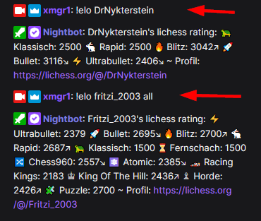
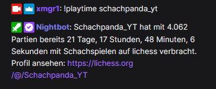
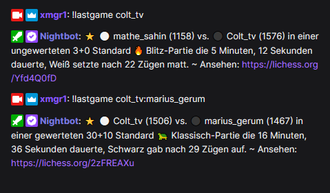
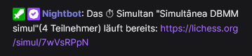
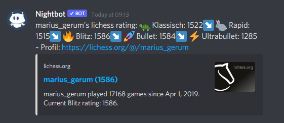

# Lichess commands for Twitch chats

A nice collection of commands you can use in Twitch or Discord to fetch Lichess ratings, general stats or the last played game.

For all available commands there's a corresponding manual which describes how to easily set
them up in **StreamElements**, **StreamLabs**, **Nightbot** or **Discord**.

> Info: es gibt auch eine [deutsche Anleitung](readme.md).

## Quicklinks

If you wanna directly dive into the setup manual:

- [Lichess rating](en/rating.md) (`!elo <user>`)
- [Playtime stats](en/playtime.md) (`!playtime <user>`)
- [Last played game results](en/lastgame.md) (`!lastgame <user>`)
- [Simul](en/simul.md) (`!simul`)

## Show Lichess rating ([Manual](en/rating.md))

By entering `!elo <user>` the rating of a Lichess user is shown in the chat:

## General stats ([Manual](en/playtime.md))

Just type `!playtime <user>` to see how many games that user has already played and how
much time they spent playing games on Lichess in total.

## Fetch last game results ([Manual](en/lastgame.md))

Write `!lastgame <user>` to fetch the result of the most recently played game of the specified user.

## Show your simul ([Manual](en/simul.md))

Write `!simul` to show your current simul on Lichess with a link, so your chat can join right away.

## General setup information

No matter if you're using StreamElements, StreamLabs or Nightbot for the commands, the corresponding
bot MUST definitely own Mod permissions and join the channel - that might be an obvious requirement
but just for the sake of completeness.

All answers are in English as long as the URL contains `lang=en`, as in the manuals. Without it, the answers are in
German.

The commands use variables like `$(querystring)` or `${1}`, which the bot replaces with whatever was typed after the
command. See [Variables](en/help/variables.md) for more.

### Discord integration

If you're using Nightbot and Nightbot is integrated on your Discord server then
you can already use all of its commands natively on Discord as well.
To set this up, just open https://nightbot.tv/integrations and let the Nightbot join on your 
Discord server - that's it already.

### Own server

All commands run on xmgr.de, you don't need to install anything. If you'd rather run them yourself,
[lichess.php](lichess.php) is a single PHP script that gives exactly the same answers. See
[Own server](en/self-hosting.md) for how to set it up.

## See it in action

Those nice streamers already use the commands for their Twitch or Discord:

- [Colt_TV1](https://www.twitch.tv/colt_tv1)
- [chris1996](https://www.twitch.tv/chris1996)
- [FritziSchach](https://www.twitch.tv/fritzischach)
- [Willeinhelm](https://www.twitch.tv/willeinhelm)
- [Ganzling](https://www.twitch.tv/ganzling)
- [GambitGambler](https://www.twitch.tv/gambitgambler)
- [GunnysWorld](https://www.twitch.tv/gunnysworld)
- [Lotnisko7](https://www.twitch.tv/lotnisko7)
- [Schachopa](https://www.twitch.tv/schachopa)

## Support

Any questions or suggestions? Just lemme know, you can contact me on Discord (`.link4`).
